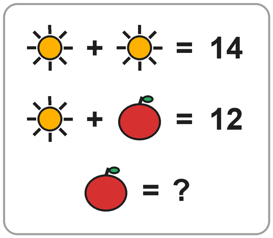

# Gaonchik – Grade 2, Stage A sample questions

Source: gaonchik.co.il, category "sample-questions" (https://gaonchik.co.il/category/sample-questions/). Collected 2026-10-07 for personal study use.

Notes:
- Question text, options and answers are copied verbatim from the site, nikud included.
- The "Explanation" lines are **short summaries in my own words**, not copies of the site's text. Each source page has a full worked solution plus "common mistake", "why each wrong answer is tempting" and "how to explain to the child" sections. Every question also has a printable PDF linked from its page.
- **Equation direction:** on posts 1043–1413 the exercises are typed into a right-to-left paragraph, so the browser shows the tokens in reverse order. For those I give the equation **as it appears on screen** (read left to right, the way the site's own solution reads it) and the raw source text below it. Posts 1119 and 19965+ use explicit LTR markup, so those match their source text exactly.
- All 27 posts in the category (pages 1 and 2 return the same list) are Stage A / grade 2, so none were dropped.

---

## Q1 – איזה עודף קיבלו? בעיית כסף
- **Type:** word-problem
- **Source:** https://gaonchik.co.il/sample-questions/999/

עֲנוּ עַל הַשְּׁאֵלָה:

נֹעָה, שִׁירָה וְיוֹתָם הָלְכוּ יַחְדָּו לַמַּכֹּלֶת. נֹעָה קָנְתָה אַרְטִיק בִּשְׁלוֹשָׁה שְׁקָלִים, שִׁירָה קָנְתָה חֲטִיף בַּחֲמִשָּׁה שְׁקָלִים וְיוֹתָם קָנָה לַחְמָנִיָּה וְשׁוֹקוֹ בְּאַרְבָּעָה שְׁקָלִים. הֵם שִׁלְּמוּ לַמּוֹכֵר עַל הַכֹּל בִּשְׁטָר שֶׁל עֶשְׂרִים שְׁקָלִים. אֵיזֶה עֹדֶף קִבְּלוּ?

- א. מַטְבֵּעַ שֶׁל חֲמִשָּׁה שְׁקָלִים.
- ב. מַטְבֵּעַ שֶׁל חֲמִשָּׁה שְׁקָלִים וּמַטְבֵּעַ שֶׁל שֶׁקֶל אֶחָד.
- ג. מַטְבֵּעַ שֶׁל חֲמִשָּׁה שְׁקָלִים וּמַטְבֵּעַ שֶׁל שְׁנֵי שְׁקָלִים.
- ד. מַטְבֵּעַ שֶׁל חֲמִשָּׁה שְׁקָלִים וְשָׁלוֹשׁ מַטְבְּעוֹת שֶׁל שֶׁקֶל אֶחָד.

**Answer:** ד

**Explanation (summary):** 3+5+4=12, 20−12=8. אין מטבע של 8, לכן 5+1+1+1. המלכודת: השאלה היא "אילו מטבעות", לא "כמה עודף".

---

## Q2 – השלמת מספר חסר בתרגיל כפל
- **Type:** missing-number
- **Source:** https://gaonchik.co.il/sample-questions/1043/

עֲנוּ עַל הַשְּׁאֵלָה:

הַשְׁלִימוּ אֶת הַמִּסְפָּר הֶחָסֵר כְּדֵי לְקַבֵּל תַּרְגִּיל נָכוֹן:

As displayed: `__ ✕ 3 = 13 + 8` (source text: `8 + 13 = 3 ✕ __`)

- א. 5
- ב. 21
- ג. 7
- ד. 10

**Answer:** ג

**Explanation (summary):** 8+13=21, ו-3 כפול 7 הוא 21. המלכודת: לבחור 21, שהוא התוצאה ולא המספר החסר.

---

## Q3 – כמה סוכריות קיבלה כל חברה?
- **Type:** word-problem
- **Source:** https://gaonchik.co.il/sample-questions/1052/

עֲנוּ עַל הַשְּׁאֵלָה:

לְאילת 31 סֻכָּרִיּוֹת. הִיא אָכְלָה 6 סֻכָּרִיּוֹת, וְאֶת הַיֶּתֶר חִלְּקָה בֵּין חָמֵשׁ חַבְרוֹתֶיהָ שָׁוֶה בְּשָׁוֶה. כַּמָּה סֻכָּרִיּוֹת קִבְּלָה כָּל חֲבֵרָה?

- א. כָּל חֲבֵרָה קִבְּלָה סֻכָּרִיָּה אַחַת.
- ב. כָּל חֲבֵרָה קִבְּלָה 3 סֻכָּרִיּוֹת.
- ג. כָּל חֲבֵרָה קִבְּלָה 5 סֻכָּרִיּוֹת.
- ד. כָּל חֲבֵרָה קִבְּלָה 6 סֻכָּרִיּוֹת.

**Answer:** ג

**Explanation (summary):** קודם חיסור (31−6=25), אחר כך חילוק (25÷5=5). מי שמחלק קודם מגיע בטעות ל-6.

---

## Q4 – איזו פעולת חשבון חסרה בתרגיל?
- **Type:** missing-number (the missing item is an operation sign)
- **Source:** https://gaonchik.co.il/sample-questions/1072/

עֲנוּ עַל הַשְּׁאֵלָה:

אֵיזוֹ פְּעֻלַּת חֶשְׁבּוֹן חֲסֵרָה בַּתַּרְגִּיל?

As displayed: `5 __ 11 = 55` (source text: `55 = 11 __ 5`)

- א. חִבּוּר.
- ב. כֶּפֶל.
- ג. חִסּוּר.
- ד. חִלּוּק.

**Answer:** ב

**Explanation (summary):** בודקים את ארבע הפעולות. רק 11×5 נותן 55. סימן מהיר: התוצאה גדולה בהרבה משני המספרים, ולכן זה כפל.

---

## Q5 – מה פירוש המילה גחון?
- **Type:** word-meaning
- **Source:** https://gaonchik.co.il/sample-questions/1083/

קִרְאוּ אֶת הַקֶּטַע:

> 1  צַבִּים חַיִּים בַּיָּם וּבַיַּבָּשָׁה. קַיָּמִים מִינִים רַבִּים שֶׁל צַבִּים. יֵשׁ צַבִּים קְטַנִּים הַשּׁוֹקְלִים
>
> 2  קִילוֹגְרָמִים בּוֹדְדִים, וְיֵש צַבִּים גְּדוֹלִים מְאֹד שֶׁיְּכוֹלִים לְהַגִּיעַ לְמִשְׁקָל שֶׁל 900
>
> 3  קִילוֹגְרָמִים! לַצַּב יֵשׁ שִׁרְיוֹן חָזָק הָעוֹטֵף אֶת הַגַּב וְהַגָּחוֹן. בְּיִשְׂרָאֵל קַיָּמִים 8
>
> 4  מִינֵי צַבִּים. חֶלְקָם בְּסַכָּנַת הַכְחָדָה.

עֲנוּ עַל הַשְּׁאֵלָה:

בְּשׁוּרָה 3 כָּתוּב: "לַצַּב יֵשׁ שִׁרְיוֹן חָזָק הָעוֹטֵף אֶת הַגַּב וְהַגָּחוֹן". מָה פֵּרוּשׁ הַמִּלָּה גָחוֹן?

- א. צַוָּאר.
- ב. בֶּטֶן.
- ג. גַּפַּיִם.
- ד. כְּתֵפַיִם.

**Answer:** ב

**Explanation (summary):** אפשר להבין מההקשר. השריון "עוטף" את הגב ואת הגחון, והגב הוא הצד העליון, ולכן הגחון הוא הצד התחתון, הבטן.

---

## Q6 – בכמה גדולה התוצאה?
- **Type:** exercise
- **Source:** https://gaonchik.co.il/sample-questions/1119/

עֲנוּ עַל הַשְּׁאֵלָה:

לִפְנֵיכֶם שְׁנֵי תַּרְגִּילִים:

`56 − 25 = __`

`6 ✕ 4 = __`

בְּכַמָּה גְּדוֹלָה הַתּוֹצָאָה שֶׁל הַתַּרְגִּיל הָרִאשׁוֹן מֵהַתּוֹצָאָה שֶׁל הַתַּרְגִּיל הַשֵּׁנִי?

- א. 7
- ב. 15
- ג. 24
- ד. 30

**Answer:** א

**Explanation (summary):** 31 ו-24. "בכמה גדולה" פירושו הפרש, ולכן מחסרים: 31−24=7. כדאי לתרגל את ההבדל בין "בכמה" (חיסור) ל"פי כמה" (חילוק).

---

## Q7 – מהו האיבר הבא בסדרה מתחלפת?
- **Type:** other (number sequence)
- **Source:** https://gaonchik.co.il/sample-questions/1134/

עֲנוּ עַל הַשְּׁאֵלָה:

מִצְאוּ אֶת הָאֵיבָר הַבָּא בַּסִּדְרָה:

As displayed (read left to right): `6, 9, 8, 11, 10, __` (source text: `__ ,10 ,11 ,8 ,9 ,6`)

- א. 9
- ב. 11
- ג. 13
- ד. 15

**Answer:** ג

**Explanation (summary):** הקפיצות מתחלפות: +3, −1, +3, −1. אחרי 10 בא +3, כלומר 13. אפשר גם לראות שתי סדרות שזורות (6, 8, 10 ו-9, 11, 13).

---

## Q8 – השלמת מספר חסר בתרגיל חיסור
- **Type:** missing-number
- **Source:** https://gaonchik.co.il/sample-questions/1168/

עֲנוּ עַל הַשְּׁאֵלָה:

הַשְׁלִימוּ אֶת הַמִּסְפָּר הֶחָסֵר כְּדֵי לְקַבֵּל תַּרְגִּיל נָכוֹן:

As displayed: `17 + 9 = 50 – __` (source text: `__ – 50 = 9 + 17`)

- א. 20
- ב. 22
- ג. 24
- ד. 26

**Answer:** ג

**Explanation (summary):** 17+9=26, ו-50 פחות 24 הוא 26. המלכודת: לבחור 26, שהיא התוצאה. כדאי להציב את התשובה חזרה בתרגיל ולבדוק.

---

## Q9 – למי מתייחסת המילה אותו?
- **Type:** pronoun
- **Source:** https://gaonchik.co.il/sample-questions/1179/

קִרְאוּ אֶת קֶטַע הַקְּרִיאָה:

> 1  בָּרֹאשׁ שֶלָּנוּ יֵשׁ גֻּלְגֹּלֶת חֲזָקָה, כְּדֵי לְהָגֵן עַל הַמּוֹחַ שֶׁלָּנוּ. הַמּוֹחַ חָשׁוּב מְאֹד לְתִפְקוּד
>
> 2  תַּקִּין שֶׁל גּופֵנוּ. הוּא מְקַבֵּל מֵידָע מֵחֲמֵשֶׁת הַחוּשִׁים שֶלָּנוּ וּמְעַבֵּד אוֹתוֹ. עַל פִּי הַמֵּידָע
>
> 3  הַזֶּה, הוּא מְנַהֵל אֶת כָּל הַמַּעֳרָכוֹת בְּגוּפֵנוּ.

עֲנוּ עַל הַשְּׁאֵלָה:

בְּשׁוּרָה 2 כָּתוּב "וּמְעַבֵּד אוֹתוֹ". לְמִי הַכַּוָּנָה בַּמִּלָּה "אוֹתוֹ"?

- א. הַמּוֹחַ.
- ב. הַגֻּלְגֹּלֶת.
- ג. הַגּוּף.
- ד. הַמֵּידָע.

**Answer:** ד

**Explanation (summary):** המוח מעבד את מה שקיבל, כלומר את המידע. המשפט הבא ("עַל פִּי הַמֵּידָע הַזֶּה") מאשר זאת. הטריק: להחליף את "אותו" בכל אחת מהאפשרויות ולקרוא בקול.

---

## Q10 – כמה מחברות יש בתיק?
- **Type:** word-problem
- **Source:** https://gaonchik.co.il/sample-questions/1196/

עֲנוּ עַל הַשְּׁאֵלָה:

בְּתִיק יֵשׁ שְׁלוֹשָה תָּאִים. בַּתָּא הָרִאשׁוֹן יֵשׁ שְׁתֵּי מַחְבָּרוֹת. בַּתָּא הַשֵּׁנִי יֵשׁ שְׁתֵּי מַחְבָּרוֹת יוֹתֵר מִבַּתָּא הָרִאשׁוֹן. וּבַתָּא הַשְּׁלִישִׁי יֵשׁ מַחְבֶּרֶת אַחַת פָּחוֹת מִבַּתָּא הַשֵּׁנִי. כַּמָּה מַחְבָּרוֹת יֵשׁ בַּתִּיק בְּסַךְ הַכָּל?

- א. תֵּשַׁע מַחְבָּרוֹת.
- ב. שְׁמוֹנֶה מַחְבָּרוֹת.
- ג. שֶׁבַע מַחְבָּרוֹת.
- ד. עֶשֶֹר מַחְבָּרוֹת.

**Answer:** א

**Explanation (summary):** 2, אחר כך 4, אחר כך 3. ביחד 9. זו שאלת שרשרת: כל תא נמדד מול התא שלפניו.

---

## Q11 – איזה מספר מתחבא בשאלה?
- **Type:** word-problem
- **Source:** https://gaonchik.co.il/sample-questions/1212/

עֲנוּ עַל הַשְּׁאֵלָה:

אֵיזֶה מִסְפָּר כַּאֲשֶׁר נְחַלֵּק אוֹתוֹ בִּ-2 נְקַבֵּל מִסְפָּר הַקָּטָן בְּ-1 מִ-8?

- א. 8
- ב. 10
- ג. 12
- ד. 14

**Answer:** ד

**Explanation (summary):** "קטן ב-1 מ-8" הוא 7. מספר שחציו 7 הוא 14. אפשר גם לבדוק כל אחת מהתשובות מול התנאי.

---

## Q12 – פי כמה גדולה התוצאה?
- **Type:** exercise
- **Source:** https://gaonchik.co.il/sample-questions/1237/

עֲנוּ עַל הַשְּׁאֵלָה:

לִפְנֵיכֶם שְׁנֵי תַּרְגִּילִים:

As displayed: `18 + 6 = __` (source text: `__ = 6 + 18`)

As displayed: `3 ✕ 4 = __` (source text: `__ = 4 ✕ 3`)

פִּי כַּמָּה גְּדוֹלָה הַתּוֹצָאָה שֶׁל הַתַּרְגִּיל הָרִאשׁוֹן מֵהַתּוֹצָאָה שֶׁל הַתַּרְגִּיל הַשֵּׁנִי?

- א. פִּי שְׁנִַים.
- ב. פִּי שְׁלוֹשָׁה.
- ג. פִּי אַרְבָּעָה.
- ד. פִּי עֲשָׂרָה.

**Answer:** א

**Explanation (summary):** 24 ו-12. "פי כמה" פירושו חילוק: 24÷12=2. מי שמחסר מקבל 12, שאינו בין התשובות.

---

## Q13 – מהו האיבר הבא בסדרה עולה?
- **Type:** other (number sequence)
- **Source:** https://gaonchik.co.il/sample-questions/1255/

עֲנוּ עַל הַשְּׁאֵלָה:

מִצְאוּ אֶת הָאֵיבָר הַבָּא בַּסִּדְרָה:

As displayed (read left to right): `16, 25, 35, 46, 58, __` (source text: `__  ,58 ,46 ,35 ,25 ,16`)

- א. 71
- ב. 70
- ג. 69
- ד. 68

**Answer:** א

**Explanation (summary):** ההפרשים הם 9, 10, 11, 12, ולכן ההפרש הבא הוא 13: 58+13=71. כל תשובה שגויה מתאימה לעצירה בהפרש אחר.

---

## Q14 – השלמת מספר חסר בתרגיל דו-שלבי
- **Type:** missing-number
- **Source:** https://gaonchik.co.il/sample-questions/1275/

עֲנוּ עַל הַשְּׁאֵלָה:

הַשְׁלִימוּ אֶת הַמִּסְפָּר הֶחָסֵר כְּדֵי לְקַבֵּל תַּרְגִּיל נָכוֹן:

As displayed: `28 : 4 = 16 – __` (source text: `__ – 16 = 4 : 28`)

- א. 7
- ב. 8
- ג. 9
- ד. 10

**Answer:** ג

**Explanation (summary):** 28:4=7, ו-16 פחות 9 הוא 7. המלכודת: לבחור 7, שהוא רק שלב ביניים.

---

## Q15 – באיזו שעה יסיים את הריצה?
- **Type:** word-problem
- **Source:** https://gaonchik.co.il/sample-questions/1334/

עֲנוּ עַל הַשְּׁאֵלָה:

רוֹנֵן רָץ 100 מֶטְרִים בְּ-6 דַּקּוֹת. הוּא יָצָא לְרִיצַת 100 מֶטְרִים בְּשָׁעָה 09:48. בְּאֵיזוֹ שָׁעָה יְסַיֵּם אֶת הָרִיצָה?

- א. בְּשָׁעָה 09:54.
- ב. בְּשָׁעָה 10:54.
- ג. בְּשָׁעָה 15:48.
- ד. בְּשָׁעָה 09:42.

**Answer:** א

**Explanation (summary):** מוסיפים 6 לדקות: 48+6=54. זה פחות מ-60, ולכן השעה לא משתנה. המרחק לא נחוץ לחישוב.

---

## Q16 – איזו תוצאה היא הקטנה ביותר?
- **Type:** exercise
- **Source:** https://gaonchik.co.il/sample-questions/1352/

עֲנוּ עַל הַשְּׁאֵלָה:

סַמְּנוּ אֶת הַתַּרְגִּיל שֶׁהַתּוֹצָאָה שֶׁלּוֹ הִיא הַקְּטַנָּה בְּיוֹתֵר.

- א. 12 + 9
- ב. 6 ✕ 3
- ג. 3 : 21 (as displayed: `21 : 3`)
- ד. 6 – 14 (as displayed: `14 – 6`)

**Answer:** ג

**Explanation (summary):** התוצאות הן 21, 18, 7, 8, והקטנה ביותר היא 7. כדאי לרשום את כל ארבע התוצאות לפני שמשווים, ולהקיף את המילה "הקטנה".

---

## Q17 – איזה משפט אי אפשר לומר?
- **Type:** reading-fact
- **Source:** https://gaonchik.co.il/sample-questions/1387/

קִרְאוּ אֶת קֶטַע הַקְּרִיאָה:

> 1  מִגְדַּל פִּיזָה הוּא בִּנְיָן מְפֻרְסָם בָּעִיר פִּיזָה שֶׁבְּאִיטַלְיָה. הִתְחִילוּ לִבְנוֹת אוֹתוֹ בִּשְׁנַת
>
> 2  1174 וְסִיְּמוּ רַק כַּעֲבֹר 200 שָׁנָה. אַחֲרֵי שֶׁבָּנוּ אֶת שְׁלוֹשׁ הַקּוֹמוֹת הָרִאשׁוֹנוֹת,
>
> 3  הַאֲדָמָה הָרַכָּה תַּחְתָּיו הֵחֵלָּה לִשְׁקֹעַ וְגָרְמָה לַבִּנְיָן לִנְטוֹת עַל צִדּוֹ. הַבִּנְיָן מַמְשִׁיךְ
>
> 4  לִנְטוֹת הַצִּדָּה בְּקֶצֶב שֶׁל סֶנְטִימֶטֶר אֶחָד כֹּל עֶשֶׂר שָׁנִים.

עֲנוּ עַל הַשְּׁאֵלָה:

אֵיזֶה מִשְׁפָּט אִי אֶפְשָׁר לוֹמַר עַל מִגְדַּל פִּיזָה?

- א. בָּנוּ אוֹתוֹ בְּמֶשֶׁךְ 200 שָׁנָה.
- ב. הוּא נוֹטֶה עַל צִדּוֹ.
- ג. סִיְּמוּ לִבְנוֹת אוֹתוֹ בִּשְׁנַת 1174.
- ד. אֶפְשָׁר לִרְאוֹת אוֹתוֹ בְּאִיטַלְיָה.

**Answer:** ג

**Explanation (summary):** זו שאלה שלילית. בשנת 1174 **התחילו** לבנות, לא סיימו. שלוש האפשרויות האחרות מופיעות בקטע. הטיפ: לסמן ✔ או ✘ ליד כל אפשרות.

---

## Q18 – מהו האיבר הבא בסדרה יורדת?
- **Type:** other (number sequence)
- **Source:** https://gaonchik.co.il/sample-questions/1413/

עֲנוּ עַל הַשְּׁאֵלָה:

מִצְאוּ אֶת הָאֵיבָר הַבָּא בַּסִּדְרָה:

As displayed (read left to right): `33, 23, 15, 9, 5, __` (source text: `__  ,5 ,9 ,15 ,23 ,33`)

- א. 0
- ב. 4
- ג. 2
- ד. 3

**Answer:** ד

**Explanation (summary):** ההפרשים הם 10, 8, 6, 4, ולכן ההפרש הבא הוא 2: 5−2=3. המלכודת: לבחור 2, שהוא ההפרש ולא האיבר.

---

## Q19 – כמה זה 64 + 28? תרגיל פתוח
- **Type:** exercise (open answer, no options)
- **Source:** https://gaonchik.co.il/sample-questions/19965/

פִּתְרוּ אֶת הַתַּרְגִּיל וְכִתְבוּ אֶת הַתְּשׁוּבָה:

`64 + 28 = ______`

**Answer:** 92

**Explanation (summary):** עשרות 60+20=80, אחדות 4+8=12, וביחד 92. טעויות נפוצות: 82 (שכחו את העשרת) או 812.

---

## Q20 – איזה מספר חסר בתרגיל ___ − 26 = 38?
- **Type:** missing-number (open answer, no options)
- **Source:** https://gaonchik.co.il/sample-questions/19966/

אֵיזֶה מִסְפָּר חָסֵר? כִּתְבוּ אוֹתוֹ כָּךְ שֶׁהַתַּרְגִּיל יִהְיֶה נָכוֹן:

`___ − 26 = 38`

**Answer:** 64

**Explanation (summary):** המספר החסר הוא 38+26=64. בדיקה: 64−26=38. טעויות נפוצות: 12 (חיסרו 38−26) או 54 (שכחו את העשרת).

---

## Q21 – גדול או קטן: איזה מספר אפשר לכתוב ב-35 + ___ < 40?
- **Type:** inequality (open answer, no options)
- **Source:** https://gaonchik.co.il/sample-questions/19967/

כִּתְבוּ מִסְפָּר שֶׁמַּתְאִים, כָּךְ שֶׁהַתַּרְגִּיל יִהְיֶה נָכוֹן. הַצַּד הַפָּתוּחַ שֶׁל הַסִּימָן פּוֹנֶה תָּמִיד לַמִּסְפָּר הַגָּדוֹל, וְיֵשׁ כַּמָּה תְּשׁוּבוֹת נְכוֹנוֹת:

`35 + ___ < 40`

**Answer:** 0, 1, 2, 3 או 4

**Explanation (summary):** 35+5 הוא בדיוק 40, ולכן צריך להוסיף פחות מ-5. הטעות הנפוצה היא 5, כי 40 אינו קטן מ-40.

---

## Q22 – חידה בציורים: כמה שווה התפוח?
- **Type:** picture-riddle
- **Source:** https://gaonchik.co.il/sample-questions/19968/

לְכָל צִיּוּר יֵשׁ מִסְפָּר. צִיּוּרִים זֵהִים – אוֹתוֹ מִסְפָּר. מָה הַמִּסְפָּר שֶׁל הַצִּיּוּר שֶׁבַּשּׁוּרָה הָאַחֲרוֹנָה?

(The image shows: ☀ + ☀ = 14 / ☀ + 🍎 = 12 / 🍎 = ?)

- א. 6
- ב. 7
- ג. 5
- ד. 12

**Answer:** ג

**Explanation (summary):** שתי שמשות הן 14, ולכן שמש אחת היא 7. 7 ועוד תפוח הם 12, ולכן התפוח הוא 5. מתחילים תמיד מהשורה שיש בה רק סוג אחד של ציור.

---

## Reading passage A – הָעֲטַלֵּף (used by Q23–Q25)

> הָעֲטַלֵּף
>
> 1 הָעֲטַלֵּף הוּא הַיּוֹנֵק הַיָּחִיד שֶׁיָּכוֹל לָעוּף.
>
> 2 הַכְּנָפַיִם שֶׁלּוֹ עֲשׂוּיוֹת מֵעוֹר דַּק, שֶׁמָּתוּחַ בֵּין
>
> 3 הָאֶצְבָּעוֹת הָאֲרֻכּוֹת שֶׁלּוֹ.
>
> 4 בַּיּוֹם הָעֲטַלֵּף יָשֵׁן בִּמְעָרָה, כְּשֶׁהוּא תָּלוּי
>
> 5 הָפוּךְ – הָרֹאשׁ לְמַטָּה וְהָרַגְלַיִם לְמַעְלָה.
>
> 6 בַּלַּיְלָה הוּא יוֹצֵא לָצוּד חֲרָקִים.
>
> 7 אֵיךְ הָעֲטַלֵּף מוֹצֵא אֶת הַדֶּרֶךְ בַּחֹשֶׁךְ? הוּא
>
> 8 מַשְׁמִיעַ צְלִילִים גְּבוֹהִים מְאוֹד, שֶׁאֲנַחְנוּ לֹא
>
> 9 שׁוֹמְעִים. הַצְּלִילִים פּוֹגְעִים בַּחֲפָצִים וְחוֹזְרִים
>
> 10 אֵלָיו, וְכָךְ הוּא יוֹדֵעַ מָה נִמְצָא לְפָנָיו.

## Q23 – למה העטלף לא מתנגש בחושך?
- **Type:** inference (the site labels it "למה / הסקה")
- **Source:** https://gaonchik.co.il/sample-questions/19969/

קִרְאוּ אֶת הַקֶּטַע: (passage A above)

עֲנוּ עַל הַשְּׁאֵלָה:

לָמָּה הָעֲטַלֵּף יָכוֹל לָעוּף בַּחֹשֶׁךְ בְּלִי לְהִתְנַגֵּשׁ?

- א. כִּי יֵשׁ לוֹ עֵינַיִם גְּדוֹלוֹת
- ב. כִּי הוּא יָשֵׁן תָּלוּי הָפוּךְ
- ג. כִּי הַצְּלִילִים שֶׁהוּא מַשְׁמִיעַ חוֹזְרִים אֵלָיו וּמְגַלִּים לוֹ מָה לְפָנָיו
- ד. כִּי הַכְּנָפַיִם שֶׁלּוֹ עֲשׂוּיוֹת מֵעוֹר דַּק

**Answer:** ג

**Explanation (summary):** הסיבה כתובה בשורות 9–10, והמילים "וכך הוא יודע" מחברות אותה לתוצאה. ב ו-ד הם פרטים נכונים מהקטע, אבל הם לא עונים על "למה". א לא כתוב בקטע בכלל.

---

## Q24 – מה המטרה של המשפט?
- **Type:** author-purpose
- **Source:** https://gaonchik.co.il/sample-questions/19970/

קִרְאוּ אֶת הַקֶּטַע: (passage A above)

עֲנוּ עַל הַשְּׁאֵלָה:

לָמָּה כָּתוּב בַּקֶּטַע "הָרֹאשׁ לְמַטָּה וְהָרַגְלַיִם לְמַעְלָה" (שׁוּרָה 5)?

- א. כְּדֵי לְהַסְבִּיר מָה זֶה "תָּלוּי הָפוּךְ"
- ב. כְּדֵי לְסַפֵּר מָה הָעֲטַלֵּף אוֹכֵל
- ג. כְּדֵי לְהַסְבִּיר אֵיךְ הוּא עָף
- ד. כְּדֵי לְתָאֵר אֶת הַמְּעָרָה

**Answer:** א

**Explanation (summary):** המילים באות מיד אחרי "תלוי הפוך" ואחרי קו מפריד, ומסבירות אותו. שאלה מנחה לילד: "מה היה חסר לך אם היו מוחקים את המילים האלה?"

---

## Q25 – על איזו שאלה אין תשובה בקטע?
- **Type:** not-answered
- **Source:** https://gaonchik.co.il/sample-questions/19971/

קִרְאוּ אֶת הַקֶּטַע: (passage A above)

עֲנוּ עַל הַשְּׁאֵלָה:

עַל אֵיזוֹ שְׁאֵלָה אֵין תְּשׁוּבָה בַּקֶּטַע?

- א. מָה אוֹכֵל הָעֲטַלֵּף?
- ב. אֵיפֹה יָשֵׁן הָעֲטַלֵּף בַּיּוֹם?
- ג. מִמָּה עֲשׂוּיוֹת הַכְּנָפַיִם שֶׁלּוֹ?
- ד. כַּמָּה עֲטַלֵּפִים גָּרִים בִּמְעָרָה אַחַת?

**Answer:** ד

**Explanation (summary):** לשלוש האפשרויות האחרות יש תשובה בקטע: חרקים, מערה ועור דק. מספר העטלפים במערה לא כתוב בקטע. כדאי לסמן בקטע את המקום של כל תשובה.

---

## Reading passage B – הַגֶּשֶׁם הָרִאשׁוֹן (used by Q26–Q27)

> הַגֶּשֶׁם הָרִאשׁוֹן
>
> 1 כָּל הַבֹּקֶר יָשְׁבָה מִיכַל לְיַד הַחַלּוֹן וְחִכְּתָה.
>
> 2 סַבְתָּא הִבְטִיחָה לָהּ שֶׁכְּשֶׁיֵּרֵד הַגֶּשֶׁם
>
> 3 הָרִאשׁוֹן, הֵן יֵצְאוּ יַחַד לִקְפֹּץ בַּשְּׁלוּלִיּוֹת.
>
> 4 אֲבָל הַשָּׁמַיִם נִשְׁאֲרוּ כְּחֻלִּים, וְהַשֶּׁמֶשׁ זָרְחָה
>
> 5 כְּמוֹ בְּאֶמְצַע הַקַּיִץ. מִיכַל
>
> 6 נֶאֶנְחָה וְהָלְכָה לְצַיֵּר.
>
> 7 פִּתְאֹם שָׁמְעָה טִפְטוּף עַל הַחַלּוֹן. הִיא רָצָה
>
> 8 לְהִסְתַּכֵּל – וְרָאֲתָה אֶת סַבְתָּא עוֹמֶדֶת
>
> 9 בֶּחָצֵר עִם צִנּוֹר מַיִם, וּמַתִּיזָה מַיִם לְמַעְלָה,
>
> 10 עַל הַחַלּוֹן. "אִם הַגֶּשֶׁם לֹא בָּא אֵלֵינוּ,"
>
> 11 צָחֲקָה סַבְתָּא, "נַעֲשֶׂה גֶּשֶׁם מִשֶּׁלָּנוּ!"
>
> 12 מִיכַל נָעֲלָה מַגָּפַיִם וְיָצְאָה. הֵן קָפְצוּ
>
> 13 בַּשְּׁלוּלִיּוֹת עַד שֶׁהַבְּגָדִים שֶׁלָּהֶן
>
> 14 הָיוּ רְטֻבִּים לְגַמְרֵי.

## Q26 – באיזה צמד המילים אינן נרדפות?
- **Type:** word-relation
- **Source:** https://gaonchik.co.il/sample-questions/19972/

קִרְאוּ אֶת הַקֶּטַע: (passage B above)

עֲנוּ עַל הַשְּׁאֵלָה:

בְּאֵיזֶה צֶמֶד הַמִּלִּים אֵינָן נִרְדָּפוֹת (אֵין לָהֶן אוֹתָהּ מַשְׁמָעוּת)?

- א. זָרְחָה – הֵאִירָה
- ב. רְטֻבִּים – יְבֵשִׁים
- ג. פִּתְאֹם – בְּבַת אַחַת
- ד. מַתִּיזָה – מְפַזֶּרֶת טִפּוֹת

**Answer:** ב

**Explanation (summary):** רטובים ויבשים הן מילים הפוכות, ושלושת הצמדים האחרים דומים במשמעות. כדאי להקיף את המילה "אינן" לפני שעונים.

---

## Q27 – מה ההפתעה בסיפור?
- **Type:** inference
- **Source:** https://gaonchik.co.il/sample-questions/19973/

קִרְאוּ אֶת הַקֶּטַע: (passage B above)

עֲנוּ עַל הַשְּׁאֵלָה:

מָה הַהַפְתָּעָה בְּשׁוּרוֹת 7–9?

- א. סוֹף סוֹף יָרַד גֶּשֶׁם חָזָק
- ב. סַבְתָּא נָסְעָה הַבַּיְתָה
- ג. הַטִּפְטוּף לֹא הָיָה גֶּשֶׁם – סַבְתָּא הִתִּיזָה מַיִם בְּצִנּוֹר
- ד. מִיכַל צִיְּרָה גֶּשֶׁם

**Answer:** ג

**Explanation (summary):** הקורא, בדיוק כמו מיכל, חושב שהתחיל גשם. מתברר שזו סבתא עם צינור. ההפתעה היא הפער בין מה שציפינו לבין מה שקרה.

---

## Not included (gaonchik)

- https://gaonchik.co.il/10-free-questions-phase-a/ : offers "20 questions" (10 math, 10 reading), but **only sent by email after signing up**. No questions are on the page itself. Skipped.
- https://gaonchik.co.il/free-second-grade-preparation/ : free worksheets, also **only by email**. Skipped.
- The email box in each post's sidebar ("10 שאלות לדוגמה להורדה") is the same gated offer.
- Each post links a printable single-question PDF (for example `https://gaonchik.co.il/wp-content/uploads/2021/08/שאלה-לדוגמה-שלב-א-1.pdf`). These were not downloaded because they hold the same question that is on the page.
