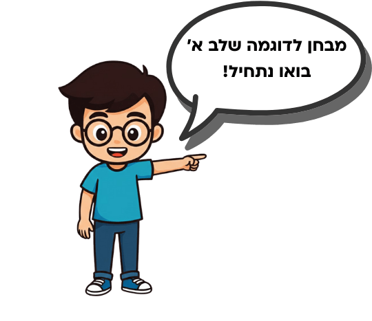

# Gaon Shel Ima (גאון של אמא) – sample test page

Source: https://gaonshelima.co.il/gifted-test-example-pdf/ (collected 2026-10-07)

## What's there

- The page title is "מבחן מחוננים כיתה ב לדוגמא - PDF להדפסה | שלב א + שלב ב".
- The page shows a few sample questions as text (Stage A section and Stage B section).
- **The PDF itself is gated.** You only get it by filling in a form (שם פרטי + אימייל + marketing consent) and it is sent by email. No direct `.pdf` link appears anywhere in the page HTML, so **no PDF was downloaded**. According to the page, the PDF adds shape and shape-sequence questions plus solutions and explanations for all questions.
- **No answers are given on the page** for the questions below. They are only in the gated PDF.
- The questions are also Ministry-style practice items, not an official test (the page's FAQ says so).

## Images

All three images were downloaded. They are decorative illustrations only and contain no question content.

| File | Size | Content |
|---|---|---|
|  `img/gaonshelima-test-example-pdf.png` | 52 KB | Cartoon: a mother and a boy doing homework |
|  `img/gaonshelima-test-example-pdf-2.png` | 27 KB | Cartoon boy with a speech bubble: "מבחן לדוגמה שלב א' / בואו נתחיל!" |
|  `img/gaonshelima-test-example-pdf-3.png` | 43 KB | Cartoon: a mother and a girl doing homework |

Original URLs: `https://7a060686.delivery.rocketcdn.me/wp-content/uploads/2026/07/test-example-pdf.png`, `…/test-example-pdf-2.png`, `…/test-example-pdf-3.png`

## Stage A questions on the page (verbatim)

Section heading on the page: "מבחן מחוננים לדוגמא – שלב א – שאלות תרגול"

### בְּעָיוֹת מִלּוּלִיּוֹת

**שאלה 1** (type: word-problem)

אַלּוֹן לָמַד לַמִּבְחָן בְּחֶשְׁבּוֹן בְּיָמִים שֵׁנִי, שְׁלִישִׁי וְרְבִיעִי. בְּכָל יוֹם הוּא פָּתַר 6 תַּרְגִּילִים יוֹתֵר מִבַּיּוֹם שֶׁלְּפָנָיו.
בַּיּוֹם הָרִאשׁוֹן הוּא פָּתַר 12 תַּרְגִּילִים. כַּמָּה תַּרְגִּילִים אַלּוֹן פָּתַר בַּסֹּךְ הַכֹּל?

- א. 24
- ב. 48
- ג. 36
- ד. 54

**שאלה 2** (type: word-problem)

בְּיוֹם שַׁבָּת דָּנִיֵּאל יָצָא לְטִיּוּל עִם מִשְׁפַּחְתּוֹ לְיַעַר בֶּן שֶׁמֶן. הֵם יָצְאוּ מֵהַבַּיִת בְּשָׁעָה 8:30 בַּבֹּקֶר, וְחָזְרוּ הַבַּיְתָה בְּשָׁעָה 16:00 אַחֲרֵי הַצָּהֳרַיִם. כַּמָּה זְמַן דָּנִיֵּאל הָיָה מִחוּץ לְבֵיתוֹ?

- א. 6 שָׁעוֹת וָחֵצִי
- ב. 7 שָׁעוֹת
- ג. 7 שָׁעוֹת וָחֵצִי
- ד. 8 שָׁעוֹת וָחֵצִי

**שאלה 3** (type: word-problem)

לִי וְאַרִיאֵל הֶחְלִיטוּ לְהָכִין שַׂקִּיּוֹת הַפְתָּעָה לִמְסִיבַּת יוֹם הַהוּלֶדֶת שֶׁל תָּמָר. הֵן שָׂמוּ בְּכָל שַׂקִּית הַפְתָּעָה 3 סוּכָּרִיּוֹת, 2 עֶפְרוֹנוֹת וּמַדְבֵּקָה אַחַת. הֵן הֵכִינוּ בְּסַךְ הַכֹּל 9 שַׂקִּיּוֹת הַפְתָּעָה.
בְכַּמָּה סוּכָּרִיּוֹת הֵם הִשְׁתַּמְּשׁוּ בְּסַךְ הַכֹּל?

- א. 36 סוּכָּרִיּוֹת
- ב. 18 סוּכָּרִיּוֹת
- ג. 21 סוּכָּרִיּוֹת
- ד. 27 סוּכָּרִיּוֹת

### פִּתְרוּ אֶת הַתַּרְגִּילִים הַבָּאִים:

These are typed right-to-left on the page. "As displayed" gives the equation the way it shows on screen, read left to right.

**שאלה 1** (type: exercise) As displayed: `35 + 47 = ___` (source text: `___ = 47 + 35`)

א. 82      ב. 72      ג. 92      ד. 84

**שאלה 2** (type: exercise) As displayed: `119 – 21 = ___` (source text: `___ = 21 – 119`)

א. 90      ב. 92      ג. 98      ד. 96

**שאלה 3** (type: exercise) As displayed: `17 + 5 = ___` (source text: `___ = 5 + 17`)

א. 22      ב. 23      ג. 24      ד. 21

**שאלה 4** (type: exercise) As displayed: `35 + 35 = ___` (source text: `___ = 35 + 35`)

א. 65      ב. 70      ג. 80      ד. 60

### קִרְאוּ אֶת קֶטַע הַקְּרִיאָה הַבָּא וְעֲנוּ עַל הַשְּׁאֵלוֹת:

> הַבַּרְדְּלָס 🐆
>
> הַבַּרְדְּלָס, שֶׁמֻּכָּר גַּם בְּשֵׁם “צִ’יטָה”, הִיא חַיָּה מְרַתֶּקֶת וּמַרְהִיבָה. זֹאת הַחַיָּה הַיַבַּשְׁתִית הֲכִי מְהִירָה בָּעוֹלָם – הִיא יְכוֹלָה לָרוּץ בְּמֶהִירוּת שֶׁל יוֹתֵר מִ-100 קמ”ש!
>
> לַבַּרְדְּלָס גּוּף רָזֶה וְאָרוֹךְ, רַגְלַיִם אֲרוּכוֹת וְזָנָב שֶׁעוֹזֵר לוֹ לִשְׁמוֹר עַל אִזּוּן בִּזְמַן הָרִיצָה. פָּנָיו מְיֻחָדוֹת – יֵשׁ לוֹ פַּסִּים שְׁחוֹרִים שֶׁיוֹרְדִים מֵהָעֵינַיִם לִכְיוּן הַפֶּה, כְּמוֹ “דְּמָעוֹת”. הַפְּסִים הַלָּלוּ עוֹזְרִים לוֹ לְהִסְתַּוּוֹת, וּלְהִתְקָרֵב לַטָּרֶף בְּלִי לְהִתְגַּלּוֹת.
>
> הַבַּרְדְּלָס חַי בְּאַפְרִיקָה וּבְאֲזוֹרִים מְעַטִּים בְּיוֹתֵר בְּאָסִיָּה. בַּעֲבָר הוּא נִצְפָּה גַּם בְּאֵזוֹרֵי אֵירוֹפָּה וְהוֹדוּ, אֲבָל כַּיּוֹם הוּא נֶחְשָׁב לְנָדִיר בְּאֵזוֹרִים אֵלֶּה.
>
> הַבַּרְדְּלָס זָקוּק לִשְׁטָחִים פְּתוּחִים כְּמוֹ סָוָנָה, שֶׁבָּהֶם יָכוֹל לָרוּץ בְּמֶהִירוּת כְּדֵי לָצוּד חַיּוֹת אַחֵרוֹת כְּמוֹ צְבָאִים וַאֲנְטִילוֹפּוֹת. הַבַּרְדְּלָס צָד בְּהַפְתָּעָה – הוּא מִתְקָרֵב בְּשֶׁקֶט, וְרַק בְּרֶגַע הַנָּכוֹן מַתְחִיל לָרוּץ בְּמֶהִירוּת.
>
> שֶׁלֹּא כְּמוֹ אַרְיֵה אוֹ נָמֵר, הַבַּרְדְּלָס אֵינוֹ חַי בְּלַהֲקָה. רוֹב הַבַּרְדְּלָסִים חַיִים לְבַד, חוּץ מִבִּתְקוּפוֹת הָרְבִיָּה שֶׁלָּהֶם אוֹ כַּאֲשֶׁר הַנְּקֵבָה מַמְלִיטָה גּוּרִים. הַגּוּרִים נִשְׁאָרִים עִם הָאֵם לְמֶשֶׁךְ שְׁנָתַיִם, וְלוֹמְדִים מִמֶּנָּה כֵּיצַד לָצוּד וּלִשְׁמוֹר עַל עַצְמָם.
>
> כַּיּוֹם הַבַּרְדְּלָס נִמְצָא בְּסַכָּנָה, וּלְפִי הַעֲרָכוֹת נִשְׁאֲרוּ פָּחוֹת מִ-7,000 בַּרְדְּלָסִים בַּטֶּבַע. הִתְפַּשְּׁטוּת הַשְּׁטָחִים הַבְּנוּיִים, פְּעֻלּוֹת אָדָם כְּגוֹן בְּנִיָּה וְצַיָּד מְסַכְּנִים אֶת הִשָּׂרְדוּתוֹ. כְּדֵי לְהַצִּיל אֶת הַבַּרְדְּלָסִים, קַיָּמוֹת תּוֹכְנִיּוֹת שׁוֹנוֹת לְהַגְדָּלַת הָאֻכְלוּסִיָּה בַּטֶּבַע, וְכַמּוּת מִזְעָרִית שֶׁל בַּרְדְּלָסִים גַּם חַיָּה בְּגַנֵּי חַיּוֹת.
>
> הַבַּרְדְּלָס הוּא דּוּגְמָה לְעוֹצְמָה, לְיֹפִי וּלְפְגִיעוּת שֶׁבַּטֶּבַע. לַמְרוֹת שֶׁהוּא חָזָק וְמָהִיר, הוּא נִזְקָק לְעֶזְרָתֵנוּ כְּדֵי שֶׁיִּהְיֶה לוֹ עָתִיד בָּעוֹלָם שֶׁלָּנוּ.

**שאלה 1** (type: reading-fact)

כֵּיצַד עוֹזְרִים הַפַּסִּים הַשְּׁחוֹרִים עַל פָּנָיו שֶׁל הַבַּרְדְּלָס?

- א. מְבַלְבְּלִים אֶת הַטּוֹרְפִים
- ב. מְסַיְּעִים לוֹ לִבְלֹט בַּשֶּׁטַח
- ג. מָגֵן עָלָיו מֵהַשֶּׁמֶשׁ
- ד. עוֹזְרִים לוֹ לְהִסְתַּוּוֹת

**שאלה 2** (type: reading-fact)

הֵיכָן חַי הַבַּרְדְּלָס כַּיּוֹם?

- א. בְּאֵירוֹפָּה וְאַמֶּרִיקָה הַדְּרוֹמִית
- ב. בְּאַפְרִיקָה וּבְאֲזוֹרִים מְעַטִּים בְּאָסִיָּה
- ג. רַק בַּמִּדְבָּרִים
- ד. בְּגַנֵּי חַיּוֹת בִּלְבַד

**שאלה 3** (type: reading-fact)

מָתַי חַיִּים בַּרְדְּלָסִים בְּקְבוּצוֹת?

- א. כְּשֶׁהֵם בּוֹרְחִים מִטּוֹרֵף
- ב. כְּשֶׁהֵם מְחַפְּשִׂים מָזוֹן
- ג. בִּתְקוּפוֹת הָרְבִיָּה
- ד. כְּשֶׁיֵּשׁ מַחְסוֹר בְּמַיִם

**שאלה 4** (type: reading-fact)

מָה לוֹמְדִים הַגּוּרִים מֵאִמָּם?

- א. אֵיךְ לְהִסְתַּתֵּר
- ב. לִבְנוֹת מַחֲסֶה
- ג. לָצוּד וּלִשְׁמוֹר עַל עַצְמָם
- ד. אֵיךְ לִשְׁחוֹת בַּנְּהָרוֹת

**Stage A total on this page:** 11 questions (word-problem 3, exercise 4, reading-fact 4). No answers are given on the page.

## Not included

- **Stage B section** ("מבחן מחוננים לדוגמא – שלב ב – שאלות תרגול"): 12 questions (4 word problems, 4 verbal analogies, 4 sentence completions). Skipped because it is Stage B, which is out of scope.
- **PDF:** only available through the email form, so it was not downloaded.
